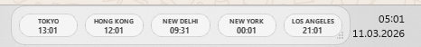

<p align="center">
  
</p>

<p align="center">
  <a href="LICENSE"></a>
  
  
  
  
</p>

**World Clock Overlay** puts the time in other cities on your desktop as transparent, frameless, always-on-top clocks: one compact strip next to the taskbar, separate floating clocks on any monitor, or both, with every position and size remembered between sessions.

> Polska wersja: [README.pl.md](README.pl.md)

## Why

If you work with people in several time zones, the Windows taskbar clock shows one of them and the extra clocks in the calendar flyout need a click. A browser tab or a phone app is one more window to find. World Clock Overlay keeps the clocks you care about in view without taking a window's worth of space:

- **Two layouts, per city.** Each city is off, part of the shared horizontal strip, or a separate floating window. Mix them: the strip for a taskbar companion, separate clocks on the monitor where you need them.
- **Out of the way.** Clocks are transparent, frameless and always on top, with an adjustable opacity and a black or white translucent theme.
- **Remembers where you put things.** Drag, scroll to scale and resize; every window's position, size and scale is saved to `config.json`. A window that would open off-screen (for example after unplugging a monitor) is placed back in the bottom-right corner.
- **Offline.** Time zones come from Python's `zoneinfo` with the bundled `tzdata` package; nothing is fetched from the network.

## Install

Requirements: Windows and Python 3.11 or newer (the `py` launcher is used to create the virtual environment).

```bat
git clone https://github.com/GameOwerMedia/WorldClocksOverlay
cd WorldClocksOverlay
install.bat
```

`install.bat` creates `.venv`, installs PySide6, tzdata and PyInstaller, and builds a single windowed executable with a default `config.json` next to it:

```
dist\WorldClockOverlay.exe
dist\config.json
```

To run from source instead, without building: `run_dev.bat`. To remove the build output (and a `WorldClockOverlay` autostart entry, if you added one yourself under `HKCU\...\CurrentVersion\Run`): `uninstall.bat`.

## Quick start

1. Start `dist\WorldClockOverlay.exe`. On first run it shows the city that matches your system time zone, snapped to the bottom-right corner of the screen.
2. Right-click a clock (or the tray icon) and choose **Add or remove clocks...**. Search the list of 105 cities and set each one to **Off**, **Line window** or **Separate window**.
3. Drag the clocks where you want them. Changes are saved automatically.

## Controls

| Input | Action |
|---|---|
| Left click and drag | move the window |
| Mouse wheel | scale up or down |
| Bottom-right grip | resize |
| Right click | context menu: add or remove clocks, seconds on or off, 24h or 12h, reload config, theme, snap to bottom-right, save position, hide or close, exit |
| Tray icon click | show or hide all clocks |
| Tray icon right click | show all, hide all, add or remove clocks, reload config, theme, exit |

## How it works

1. **Configuration.** `config.json` lives next to the executable (or next to `app.py` when run from source). On the first start of the built executable, a default copy is written there. Edits made through the UI are written back after a short debounce.
2. **Clocks.** Each enabled city is rendered by a card that refreshes on a timer and fits its font to the card size. Cities set to **Line window** share one horizontal strip; each **Separate window** city gets its own frameless window.
3. **Placement.** New windows snap to the bottom-right of the current screen until you move them. Saved positions are checked against all connected screens before they are used.
4. **Staying on top.** The windows set the always-on-top flag and raise themselves again whenever they lose activation, so clicking another window does not bury them.

## Configuration

All settings are in `config.json` and can be changed through the menus. To edit by hand, close the app, edit the file, and start it again (or use **Reload config**).

| Key | Default | Meaning |
|---|---|---|
| `window.opacity` | `0.82` | background opacity of the clocks |
| `window.always_on_top` | `true` | keep the clocks above other windows |
| `window.snap_bottom_right` | `true` | place the strip in the bottom-right corner until it is moved |
| `display.show_seconds` | `false` | show seconds |
| `display.use_24h` | `true` | 24-hour format; `false` for 12-hour with AM/PM |
| `display.font_size_city`, `display.font_size_time` | `11`, `20` | base font sizes before scaling |
| `display.theme` | `"black"` | `"black"` or `"white"` |
| `cities[]` | 105 cities | `label`, IANA `timezone`, `placement` (`off`, `line`, `window`) and the saved window geometry |

To add a city that is not on the list, add an entry to `cities` with a `label` and an IANA time zone name such as `"America/Bogota"`.

## FAQ

**Does it need the internet?** No. Time zone data is local.

**Does it start with Windows?** Not by itself. Put a shortcut to `WorldClockOverlay.exe` in `shell:startup` if you want it to.

**Is it a taskbar extension?** No. The clocks are floating windows that sit near the taskbar; they do not become part of it.

## Limitations

- Windows is the only platform with scripts and a build. The code is plain PySide6 and may run elsewhere with `python app.py`, but that is untested.
- No prebuilt release: you build the executable yourself with `install.bat`.
- The tray icon is a stock system icon.

## Repository layout

| Path | Purpose |
|---|---|
| `app.py` | the whole application |
| `config.json` | default configuration and city list |
| `requirements.txt` | PySide6 and tzdata |
| `install.bat` | virtual environment, dependencies and the PyInstaller build |
| `build.bat` | standalone build script |
| `run_dev.bat` | run from source |
| `uninstall.bat` | remove build output and an autostart entry |
| `README.pl.md` | Polish README |

## License

[MIT](LICENSE)
